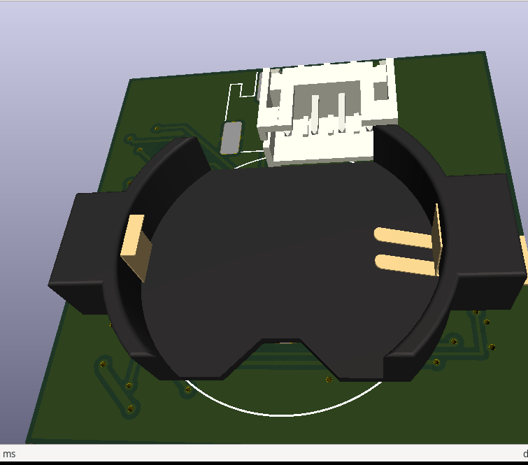
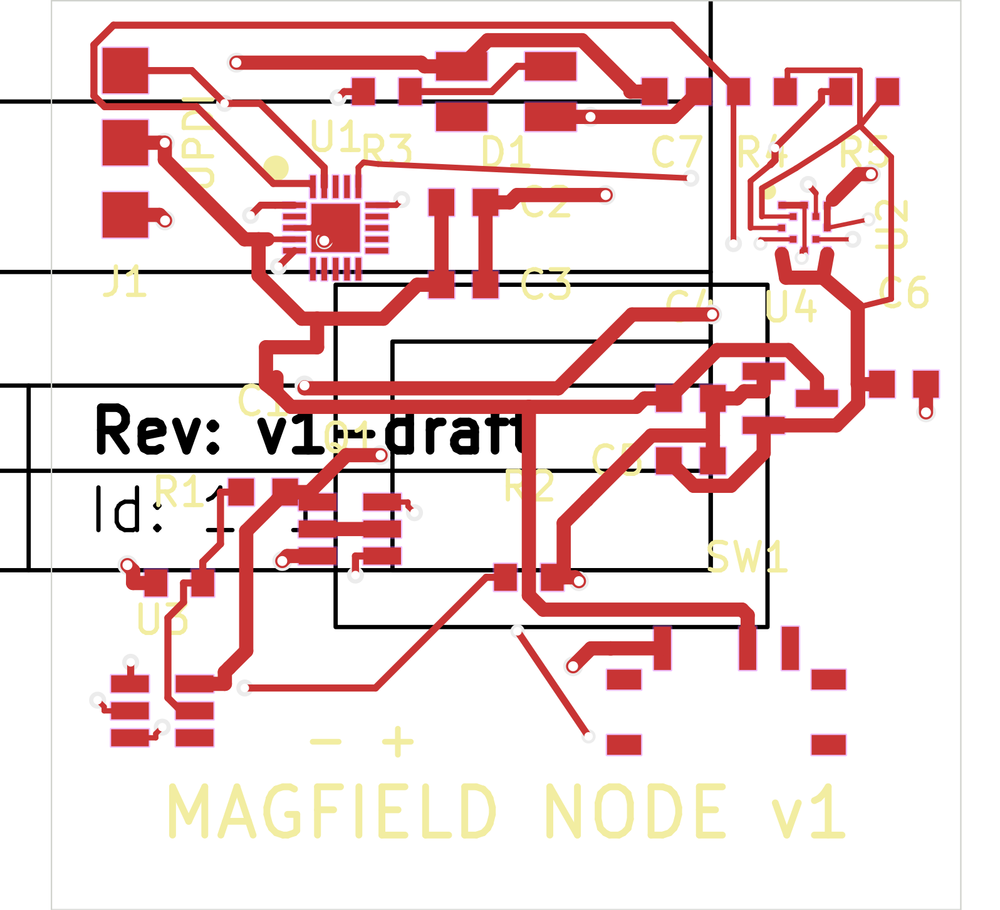
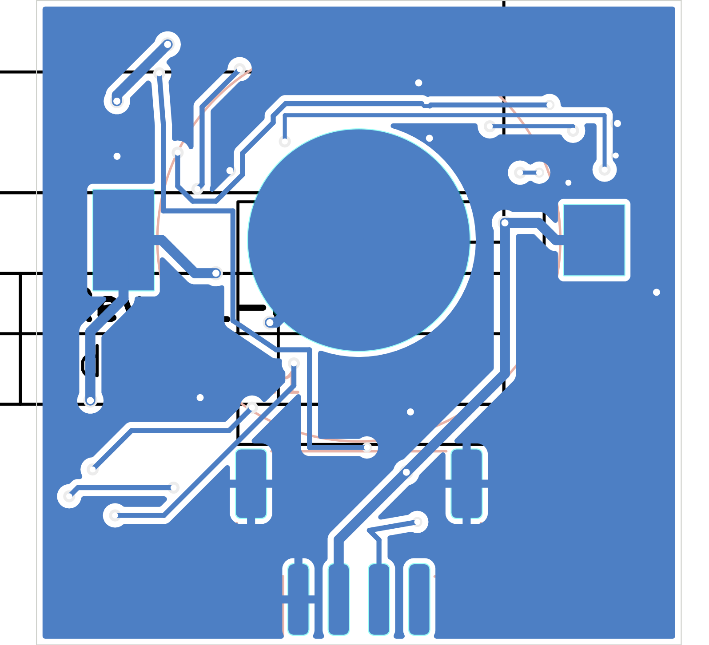

# magfield-nodes

> Magnetic-field visualization with ~100 coin-cell-sized LED nodes — a grid of tiny boards that turn invisible magnetic-field distortion into light.
> コインセル大の小さな基板を約100個並べ、目に見えない磁場の歪みや揺らぎを「光の色」として見える化するプロジェクトです。

## 概要

ボタン電池くらいの小さな基板（ノード）に、地磁気センサー・小さなマイコン・RGB LEDを載せ、磁場の向きや強さに応じてLEDの色をリアルタイムに変えます。この基板を10メートル四方に1メートル間隔で約100個並べると、その空間の中で磁場がどう歪んでいるか・揺らいでいるかが、光の分布として目で見えるようになります。

## ノード基板（v3）








### 主な仕様

| 項目 | 内容 |
|---|---|
| 基板サイズ | 32 × 32 mm、2層、表面実装は片面のみ（コネクタと電池ホルダーは裏面） |
| マイコン | ATtiny1616-MNR（電池直結で動作、書き込みはUPDI） |
| 地磁気センサー | Bosch BMM150（I2C、3.0V LDOレールから給電） |
| LED | WS2812B-MINI ×1（磁場の向き・変化を色で表示） |
| 電池 | LIR2032 充電式コインセル（約40mAh、公称3.6/3.7V）※LCSCに取り扱いがないため別途調達 |
| 電池保護 | DW01A + FS8205A（過放電保護を全ノードに搭載） |
| 電池ホルダー | MYOUNG MY-2032-10（裏面） |
| 接続 | JST PH 4ピン（Grove互換形状、裏面・下辺）: GND / 充電(VBAT) / UPDI / ID予備 |

### 設計のポイント

- **充電は基板側に載せない**: 充電管理は外部の充電ボード側に集約し、ノードは充電中は電源OFF。充電ラインは負荷スイッチの手前から取るため、充電中は充電回路だけが電池につながります。
- **磁気的な配慮**: センサーは電流経路・電池から最も遠い基板の角に配置し、LED（最大電流源）の配線ループ面積を小さくしています。基板自身が作る磁場のオフセットは、ノードごとの校正で吸収する前提です。
- **書き込み**: UPDIパッド（表面）とJST PHコネクタ経由の両方から書き込み可能。専用書き込み機なしで済むよう、充電ボード経由の書き込みも計画しています。

詳細は [node/DESIGN.md](node/DESIGN.md) を参照してください。

## 充電ボード（ハブ、WIP）

ノード10台をまとめて充電・管理するボードです。頭脳は持たせず、M5StackからPort A（I2C）経由で制御する構成にしています。

- 充電IC ×10（MCP73831、約40mA = 1C）、80〜90%で止めるカットオフ制御
- I2C GPIOエクスパンダ＋アナログ切替＋I2C ADCで、全チャンネルの状態監視と電池電圧読み取り
- UPDI信号の切替により、差したノードへのプログラム書き込みにも対応予定
- 充電用電源はボード側のUSB-C 5V入力から供給

KiCadファイル一式は [charge-board/](charge-board/) に追加済みです（4層基板、WIP — DRC残件あり、未発注。現状は charge-board/DESIGN.md 参照）。

## ステータス（2026-10-30時点）

- ノード基板 v3: 設計完了（KiCad 8、DRCエラー0・未接続0）。**未発注** — 発注前に要確認の項目が [node/DESIGN.md](node/DESIGN.md) に残っています（FS8205Aのピン配置、ホルダーのランドパターン、WS2812B-MINIのパッド順、LDOとスライドスイッチのLCSC型番など）。
- 充電ボード: KiCadファイル追加済み（4層、WIP）。DRC残件（未接続1件・クリアランス4件）があり未発注。
- ファームウェア（ノード／M5Stack側とも）: 未着手。要件はDESIGN.mdに記録しています（常時点灯／点滅モード、感度マッピングのパラメータ化など）。

## リポジトリ構成

```
.
├── README.md            このファイル
├── LICENSE              MIT
├── bom-estimate.md      ノード基板のBOM見積もり（LCSC価格ベース）
├── node/                ノード基板 (KiCad 8)
│   ├── magfield-node.kicad_pro / .kicad_sch / .kicad_pcb
│   ├── DESIGN.md        設計仕様・判断記録・未確認事項
│   ├── MAGFIELD.pretty/ カスタムフットプリント（基板埋め込み分から復元）
│   ├── fp-lib-table
│   ├── gerbers/         製造用ガーバー（v3）
│   └── iterations/      レイアウト図・外観図
└── charge-board/        充電ボード（ハブ、KiCadファイル一式、WIP）
```

## ライセンス

MIT License — [LICENSE](LICENSE) を参照してください。
